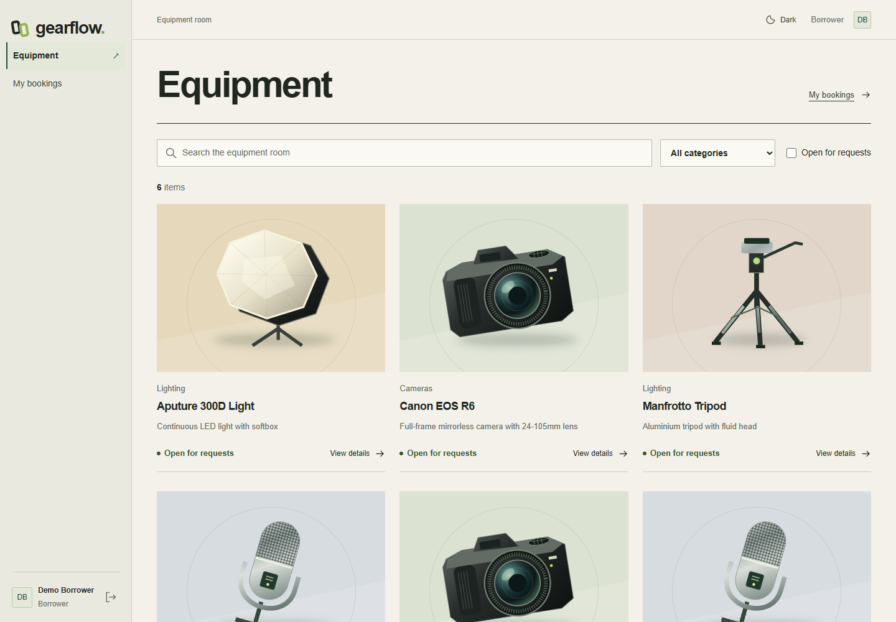
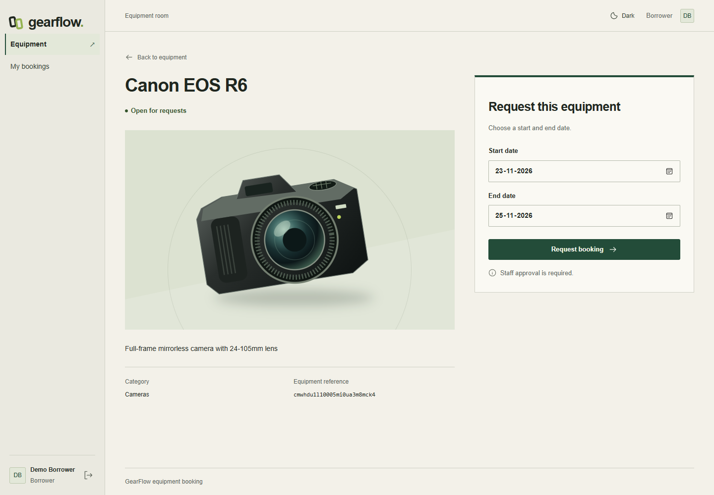
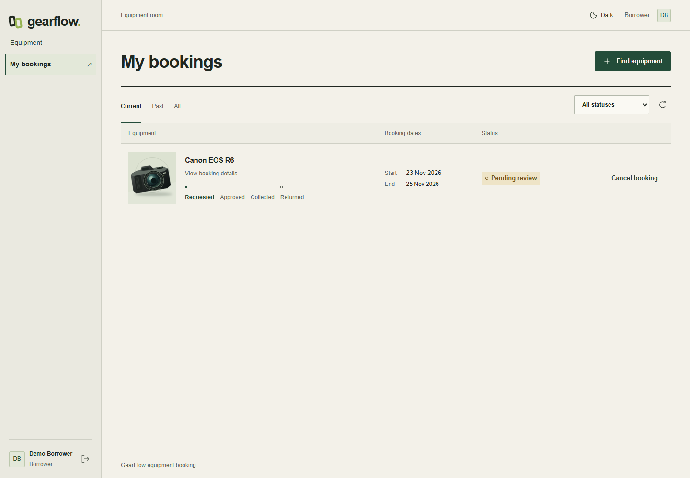
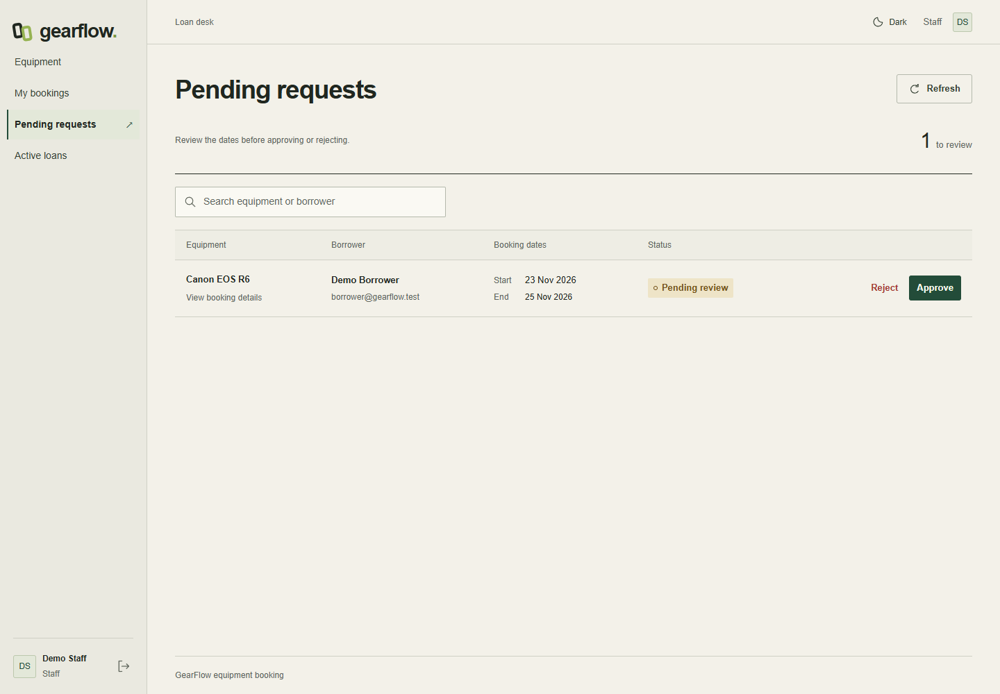
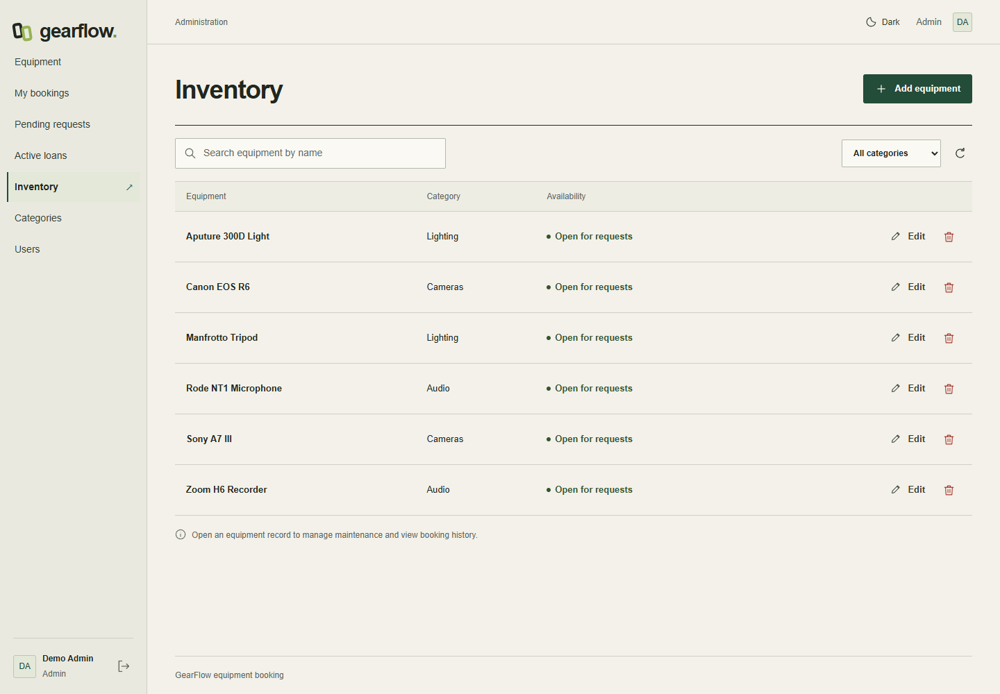
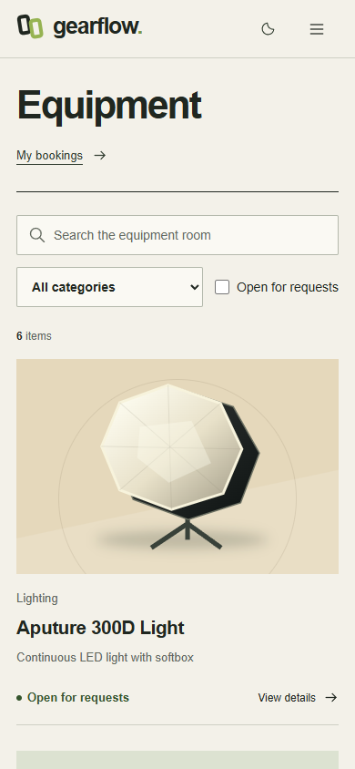

# GearFlow

GearFlow was built as part of a larger university project for SWE40006 - Software Deployment and Evolution at Swinburne University of Technology.

The repo was only one part of the overall project. We also had to design the architecture, prepare diagrams and documentation, write a roughly 50-page final report, and prepare the final presentation/demo, which I can't share here because of university submission requirements. We started with the idea of building something meaningful enough to actually deploy, test and reason about properly. The point wasn't to pretend this needed to scale to millions of users and start adding load balancers everywhere, but to have a real enough system where the deployment architecture and trade-offs actually mattered.

GearFlow itself is an equipment booking system where borrowers can request equipment, staff can approve and manage loans, and admins can manage inventory and users.

**More detail:** [Application docs](docs/APP.md) · [Deployment and operations](docs/DEVOPS.md)

---

## Application

<p align="center">
  
</p>

Borrowers can browse equipment, request a booking and keep track of their current and past bookings.

| Booking request | My bookings |
| --- | --- |
|  |  |

Staff can review requests, approve or reject them, and record the rest of the loan flow. Admins can manage the inventory and other application data.

| Staff requests | Admin inventory |
| --- | --- |
|  |  |

The frontend is also responsive for smaller screens.

<p align="center">
  
</p>

---

## Deployment side

This was the main part of the project.

```text
GitHub
  -> GitHub Actions checks
  -> Docker images pushed to GHCR with the commit SHA
  -> deploy to staging
  -> Playwright runs against deployed staging
  -> promote the same SHA to production
  -> Prometheus + Node Exporter + Grafana
```

A few things that were implemented and verified:

- pull requests run the application checks before release work
- release images are tagged with the full Git commit SHA
- staging and production use separate EC2 environments and databases
- Playwright runs against the deployed staging application
- production only runs after the staging test passes
- the same tested SHA is promoted to production instead of rebuilding it
- production monitoring uses Prometheus, Node Exporter and Grafana

The AWS servers are not kept online as a permanent public demo.

For the actual deployment setup, scripts, Compose files, monitoring and release flow, see [docs/DEVOPS.md](docs/DEVOPS.md).

---

## Stack

- **Frontend:** React, TypeScript, Vite
- **Backend:** Node.js, Express, TypeScript
- **Database:** PostgreSQL, Prisma
- **Testing:** Vitest, Supertest, Playwright
- **Deployment:** Docker, Docker Compose, GitHub Actions, GHCR, AWS EC2
- **Monitoring:** Prometheus, Node Exporter, Grafana
- **Web server:** Nginx

---

## Run locally

```bash
cp .env.example .env
docker compose up --build -d
docker compose --profile seed run --rm seed
```

Then open:

```text
http://localhost:8080
```

To stop it:

```bash
docker compose down
```

See [docs/APP.md](docs/APP.md) for the application details and demo users.

---

## Project status

The university project is complete.

The repo keeps the application, tests, deployment setup and documentation together even though the AWS environments are no longer kept running.
